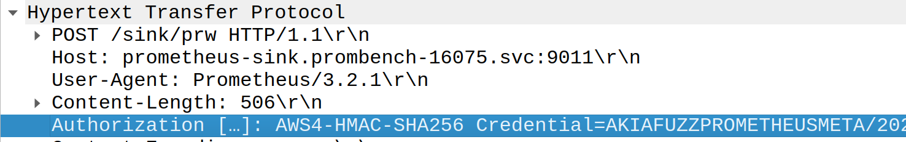
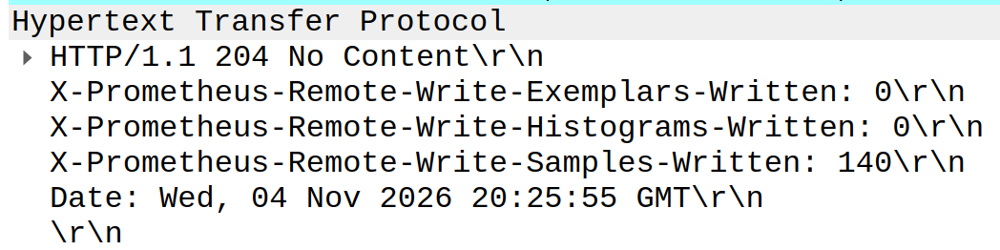

# Example

The example below samples one full key per "coverage tier" (see STATISTICS.md), and shows it traced through the inputs and outputs of the workflow, for each step it gets through.

The rows come from a paramtrack run with `--testbed prombench` (2026-11-04).

| Tier | Full key | Concrete config value |
|---|---|---|
| not documented | `scrape_configs.basic_auth.password_ref` | (not set) |
| documented | `scrape_configs.oauth2.client_id` | (not set) |
| in concrete config | `global.scrape_interval` | `5s` |
| searched | `alerting.alertmanagers.proxy_url` | `http://127.0.0.1:3128` |
| matched | `remote_write.sigv4.access_key` | `AKIAFUZZPROMETHEUSMETA` |

### Module source code
The struct field each key's last segment comes from:

<small>

```
# prometheus/common@v0.62.0 config/http_config.go:140, in type BasicAuth
PasswordRef string `yaml:"password_ref,omitempty" json:"password_ref,omitempty"`
# prometheus/common@v0.62.0 config/http_config.go:235, in type OAuth2
ClientID string `yaml:"client_id" json:"client_id"`
# prometheus config/config.go:442, in type GlobalConfig
ScrapeInterval model.Duration `yaml:"scrape_interval,omitempty"`
# prometheus/common@v0.62.0 config/http_config.go:1461, in type ProxyConfig
ProxyURL URL `yaml:"proxy_url,omitempty" json:"proxy_url,omitempty"`
# prometheus/sigv4@v0.1.1 sigv4_config.go:27, in type SigV4Config
AccessKey string `yaml:"access_key,omitempty"`
```

</small>

### `unmarshaler_subgraph.text`
The vertex holding each field, with the field's `Tags` and `FieldKinds` entries:

<small>

```
common/config.BasicAuth   Tags[PasswordRef]='yaml:"password_ref,omitempty" json:"password_ref,omitempty"'  FieldKinds[PasswordRef]=string
common/config.OAuth2      Tags[ClientID]='yaml:"client_id" json:"client_id"'                               FieldKinds[ClientID]=string
/config.GlobalConfig      Tags[ScrapeInterval]='yaml:"scrape_interval,omitempty"'                          FieldKinds[ScrapeInterval]=number
common/config.ProxyConfig Tags[ProxyURL]='yaml:"proxy_url,omitempty" json:"proxy_url,omitempty"'           FieldKinds[ProxyURL]=struct
sigv4.SigV4Config         Tags[AccessKey]='yaml:"access_key,omitempty"'                                    FieldKinds[AccessKey]=string
```

</small>

### `full_keys.yaml`
<table width="100%" style="table-layout: fixed"><tr><td valign="top" width="50%">

Each key's line, with its parents' lines:

<small>

```
scrape_configs:
    basic_auth:
        password_ref: {}  # not documented; string
    oauth2:
        client_id: {}  # documented; string
global:
    scrape_interval: {}  # documented; number
alerting:
    alertmanagers:
        proxy_url: {}  # documented; struct
remote_write:
    sigv4:
        access_key: {}  # documented; string
```

</small>

</td><td valign="top" width="50%">

### concrete config
Notice `password_ref` and `client_id` have no rows.

<small>

```
global:
  scrape_interval: 5s

alerting:
  alertmanagers:
  - kubernetes_sd_configs:
    ...
    proxy_url: http://127.0.0.1:3128

remote_write:
- url: http://prometheus-sink.prombench-16075.svc:9011/sink/prw
  name: meta-sink-sigv4
  ...
  sigv4:
    region: us-east-1
    access_key: AKIAFUZZPROMETHEUSMETA
```

</small>

</td></tr></table>

### `configkeys.csv`
(long cells shortened with `...`, `github.com/prometheus` prefix cut, Unmarshaler and Num Unmarshalers columns removed).

Notice the two keys not in the concrete config have only `graph` rows.

| <small>param_key</small> | <small>source</small> | <small>pattern</small> | <small>values</small> | <small>value kind</small> | <small>Unmarshaler Path</small> | <small>section keys</small> |
|---|---|---|---|---|---|---|
| <small>`scrape_configs.basic_auth.password_ref`</small> | <small>`graph`</small> |  |  | <small>`string`</small> | <small>`/config.Config => /config.ScrapeConfig => common/config.HTTPClientConfig => common/config.BasicAuth`</small> | <small>`scrape_configs.basic_auth.password; scrape_configs.basic_auth.password_file; scrape_configs.basic_auth.password_ref; scrape_configs.basic_auth.username; scrape_configs.basic_auth.username_file; scrape_configs.basic_auth.username_ref`</small> |
| <small>`scrape_configs.oauth2.client_id`</small> | <small>`graph`</small> |  |  | <small>`string`</small> | <small>`/config.Config => /config.ScrapeConfig => common/config.HTTPClientConfig => common/config.OAuth2`</small> | <small>`scrape_configs.oauth2.client_id; scrape_configs.oauth2.client_secret; scrape_configs.oauth2.client_secret_file; scrape_configs.oauth2.client_secret_ref; scrape_configs.oauth2.endpoint_params.*; scrape_configs.oauth2.scopes; scrape_configs.oauth2.token_url`</small> |
| <small>`global.scrape_interval`</small> | <small>`both`</small> | <small>`global.scrape_interval`</small> | <small>`["5s"]`</small> | <small>`number`</small> | <small>`/config.Config => /config.GlobalConfig`</small> | <small>`global.body_size_limit; global.evaluation_interval; global.external_labels.*; ...; global.scrape_interval; ...`</small> |
| <small>`alerting.alertmanagers.proxy_url`</small> | <small>`both`</small> | <small>`alerting.alertmanagers.proxy_url`</small> | <small>`["http://127.0.0.1:3128"]`</small> | <small>`struct`</small> | <small>`/config.Config => /config.AlertingConfig => /config.AlertmanagerConfigs => /config.AlertmanagerConfig => common/config.HTTPClientConfig => common/config.ProxyConfig`</small> | <small>`alerting.alertmanagers.no_proxy; alerting.alertmanagers.proxy_connect_header.*; alerting.alertmanagers.proxy_from_environment; alerting.alertmanagers.proxy_url`</small> |
| <small>`remote_write.sigv4.access_key`</small> | <small>`both`</small> | <small>`remote_write.sigv4.access_key`</small> | <small>`["AKIAFUZZPROMETHEUSMETA"]`</small> | <small>`string`</small> | <small>`/config.Config => /config.RemoteWriteConfig => sigv4.SigV4Config`</small> | <small>`remote_write.sigv4.access_key; remote_write.sigv4.profile; remote_write.sigv4.region; remote_write.sigv4.role_arn; remote_write.sigv4.secret_key; remote_write.sigv4.use_fips_sts_endpoint`</small> |

<table width="100%" style="table-layout: fixed"><tr><td valign="top" width="50%">

### `param_values.txt`

Notice `5s` isn't there: `--strings-only` leaves out numbers, so `global.scrape_interval`'s rows stop here.

<small>

```
http://127.0.0.1:3128
AKIAFUZZPROMETHEUSMETA
```

</small>

</td><td valign="top" width="50%">

### `param_keys.txt`

Notice `http://127.0.0.1:3128` is an ambiguous value: 6 concrete keys.

<small>

```
http://127.0.0.1:3128:alerting.alertmanagers.kubernetes_sd_configs.proxy_url,alerting.alertmanagers.proxy_url,scrape_configs.proxy_url,scrape_configs.kubernetes_sd_configs.proxy_url,remote_write.proxy_url,remote_read.proxy_url
AKIAFUZZPROMETHEUSMETA:remote_write.sigv4.access_key
```

</small>

</td></tr></table>

### `events.jsonl` (`stacklog.txt` is a reformatted version)
The request that contains `remote_write.sigv4.access_key` (rest of `stack`, `ancestry` and `call_chain` omitted):

<small>

```
{"kind": "Request sent", "message": {"req.Method": "POST", "req.URL.Host": "prometheus-sink.prombench-16075.svc:9011", "req.URL.Path": "/sink/prw", "req.URL.RawQuery": ""}, "context": {"source": "req.Context()", "type": "context.Context", "context_id": "id:79"}, "request_id": {"method": "POST", "host": "prometheus-sink.prombench-16075.svc:9011", "path": "/sink/prw"}, "api_id": "github.com/prometheus"}
goroutine 694 [running]:
net/http.(*Transport).roundTrip(...)
net/http.(*Transport).RoundTrip(...)
common/config.(*headersRoundTripper).RoundTrip(...)
prometheus/storage/remote.(*injectHeadersRoundTripper).RoundTrip(...)
sigv4.(*sigV4RoundTripper).RoundTrip(...)
	/go/pkg/mod/sigv4@v0.1.1/sigv4.go:151 +0x862
go.opentelemetry.io/contrib/instrumentation/net/http/otelhttp.(*Transport).RoundTrip(...)
```

</small>

Notice `sigV4RoundTripper.RoundTrip` appears in the chain, so argmatch will instrument it.

### `matches.csv`
Notice `http://127.0.0.1:3128` has no rows: `ProxyURL` is a parsed `url.URL`, so the exact string is never in memory, and `alerting.alertmanagers.proxy_url`'s rows stop here. `AKIAFUZZPROMETHEUSMETA` has 674 match rows, in 163 calls of 16 functions, all on the remote write path (`sigV4RoundTripper.RoundTrip`, otelhttp's `Transport.RoundTrip`, `Client.Store`, `QueueManager`, `shards` and `MetadataWatcher` methods, and `Storage` and `WriteStorage.ApplyConfig`). One of `AKIAFUZZPROMETHEUSMETA`'s matches:


| <small>needle</small> | <small>function</small> | <small>expression</small> | <small>call</small> | <small>types</small> |
|---|---|---|---|---|
| <small>`AKIAFUZZPROMETHEUSMETA`</small> | <small>`sigv4.(*sigV4RoundTripper).RoundTrip`</small> | <small>`rt.signer.Credentials.creds.AccessKeyID`</small> | <small>`286`</small> | <small>`sigv4.sigV4RoundTripper,github.com/aws/aws-sdk-go/aws/signer/v4.Signer,github.com/aws/aws-sdk-go/aws/credentials.Credentials,github.com/aws/aws-sdk-go/aws/credentials.Value`</small> |

### `matches.calls.csv`
Call 286's row (columns `call,function,ancestry,stack`), with its ancestry and stack shortened:

<small>

```
286,sigv4.(*sigV4RoundTripper).RoundTrip,
  ancestry: goroutine 705
            created by prometheus/storage/remote.(*shards).start in goroutine 308
            [originating from goroutine 308]:
            prometheus/storage/remote.(*shards).start(...)
            prometheus/storage/remote.(*QueueManager).Start(...)
            ...
  stack:    goroutine 705 [running]:
            sigv4.(*sigV4RoundTripper).RoundTrip(...)
            	/go/pkg/mod/sigv4@v0.1.1/sigv4.go:105 +0x11c
            go.opentelemetry.io/contrib/instrumentation/net/http/otelhttp.(*Transport).RoundTrip(...)
            net/http.send(...)
            ...
```

</small>

### `joined.csv`
The request above and its response:

| <small>message_kind</small> | <small>message_label</small> | <small>needle</small> |
|---|---|---|
| <small>`Request sent`</small> | <small>`{api_id: github.com/prometheus, method: POST, path: /sink/prw}`</small> | <small>`AKIAFUZZPROMETHEUSMETA`</small> |
| <small>`Response received`</small> | <small>`{req.Method: POST, req.URL.Path: /sink/prw, resp.StatusCode: 204, api_id: github.com/prometheus}`</small> | <small>`AKIAFUZZPROMETHEUSMETA`</small> |

### `label_keys.csv`
The request's rows for the section of `remote_write.sigv4.access_key`. `section_keys` is the same in each: `remote_write.sigv4.access_key; remote_write.sigv4.profile; remote_write.sigv4.region; remote_write.sigv4.role_arn; remote_write.sigv4.secret_key; remote_write.sigv4.use_fips_sts_endpoint`. The response (`{req.Method: POST, req.URL.Path: /sink/prw, resp.StatusCode: 204, api_id: github.com/prometheus}`) has the same rows.

- **Evidence rows** (the first 3): `access_key`, `region` and `secret_key` were matched in calls that join with the request, so each has confidence 1.
- **Inferred rows** (the last 3): the section's other keys weren't matched for the request, so each gets the share of the section that's evidence: 3 of its 6 keys (`confidence_all` 0.5), but 3 of its 3 eligible keys (`confidence_eligible` 1.0), since the concrete config doesn't set the others.

| <small>message_kind</small> | <small>message_label</small> | <small>needle</small> | <small>concrete_key</small> | <small>full_key</small> | <small>section</small> | <small>evidence</small> | <small>eligible</small> | <small>confidence_all</small> | <small>confidence_eligible</small> |
|---|---|---|---|---|---|---|---|---|---|
| <small>`Request sent`</small> | <small>`{api_id: github.com/prometheus, method: POST, path: /sink/prw}`</small> | <small>`AKIAFUZZPROMETHEUSMETA`</small> | <small>`remote_write.sigv4.access_key`</small> | <small>`remote_write.sigv4.access_key`</small> | <small>`remote_write.sigv4 @ sigv4.SigV4Config`</small> | <small>`True`</small> | <small>`True`</small> | <small>`1`</small> | <small>`1`</small> |
| <small>`Request sent`</small> | <small>`{api_id: github.com/prometheus, method: POST, path: /sink/prw}`</small> | <small>`us-east-1`</small> | <small>`remote_write.sigv4.region`</small> | <small>`remote_write.sigv4.region`</small> | <small>`remote_write.sigv4 @ sigv4.SigV4Config`</small> | <small>`True`</small> | <small>`True`</small> | <small>`1`</small> | <small>`1`</small> |
| <small>`Request sent`</small> | <small>`{api_id: github.com/prometheus, method: POST, path: /sink/prw}`</small> | <small>`fuzz-sigv4-secret-key`</small> | <small>`remote_write.sigv4.secret_key`</small> | <small>`remote_write.sigv4.secret_key`</small> | <small>`remote_write.sigv4 @ sigv4.SigV4Config`</small> | <small>`True`</small> | <small>`True`</small> | <small>`1`</small> | <small>`1`</small> |
| <small>`Request sent`</small> | <small>`{api_id: github.com/prometheus, method: POST, path: /sink/prw}`</small> |  |  | <small>`remote_write.sigv4.profile`</small> | <small>`remote_write.sigv4 @ sigv4.SigV4Config`</small> | <small>`False`</small> | <small>`False`</small> | <small>`0.5`</small> | <small>`1.0`</small> |
| <small>`Request sent`</small> | <small>`{api_id: github.com/prometheus, method: POST, path: /sink/prw}`</small> |  |  | <small>`remote_write.sigv4.role_arn`</small> | <small>`remote_write.sigv4 @ sigv4.SigV4Config`</small> | <small>`False`</small> | <small>`False`</small> | <small>`0.5`</small> | <small>`1.0`</small> |
| <small>`Request sent`</small> | <small>`{api_id: github.com/prometheus, method: POST, path: /sink/prw}`</small> |  |  | <small>`remote_write.sigv4.use_fips_sts_endpoint`</small> | <small>`remote_write.sigv4 @ sigv4.SigV4Config`</small> | <small>`False`</small> | <small>`False`</small> | <small>`0.5`</small> | <small>`1.0`</small> |

### Packet captures
Here are the corresponding messages from a packet capture running alongside the workflow. In this case, the request contains the value corresponding to the key that influenced it, but that will not always be the case  (e.g. if the key influenced the message in some way other than being copied into it, e.g. in how a received message is handled)


